# CyberGate manager dashboard

A manager's view of the CyberGate skills assessment: who is ready for promotion, which gaps are most common, who the key people are, and whether employees did their training.

**The whole app is one HTML file**, [`build/cybergate-dashboard.html`](build/cybergate-dashboard.html). It reads its data from the Excel workbook [`data/cybergate-mock-data.xlsx`](data/cybergate-mock-data.xlsx) in this repo. It makes no other request: no internet, no CDN, no fonts, no analytics, so it works in airplane mode.

> All people, emails (`@acme-corp.example`) and the client "Acme Corp" in the workbook are fictional.

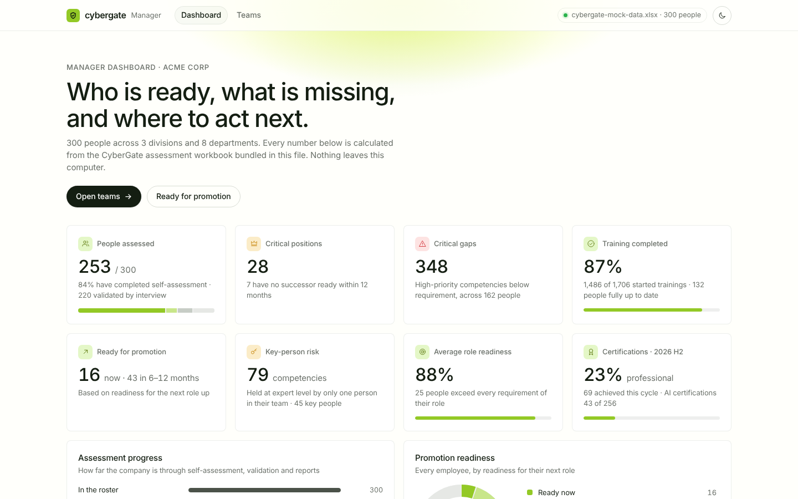

---

## Contents

1. [Quick start](#1-quick-start)
2. [Requirements](#2-requirements)
3. [Get the code](#3-get-the-code)
4. [Run the app](#4-run-the-app)
5. [Use the app](#5-use-the-app)
6. [Build the final file (and screenshots)](#6-build-the-final-file-and-screenshots)
7. [The data: the Excel workbook](#7-the-data-the-excel-workbook)
8. [Offline and network guarantees](#8-offline-and-network-guarantees)
9. [How the numbers are calculated](#9-how-the-numbers-are-calculated)
10. [Project structure](#10-project-structure)
11. [Troubleshooting](#11-troubleshooting)

---

## 1. Quick start

```bash
git clone https://github.com/Thevaultboy11/cyberpunk-clone.git
cd cyberpunk-clone
npm install
npm run serve
```

Open the address it prints, **http://localhost:4321/build/cybergate-dashboard.html**. The dashboard loads `data/cybergate-mock-data.xlsx` by itself.

**Not a developer?** You don't need Node at all: download the repo and double-click `build/cybergate-dashboard.html`. It asks you once for the workbook, which is `data/cybergate-mock-data.xlsx`. See [4.2](#42-double-click-the-html-file-no-installation).

---

## 2. Requirements

| What | Version | Needed for |
| --- | --- | --- |
| A browser | Current Chrome, Edge, Firefox or Safari | Using the app |
| Git | any | Cloning the repo |
| Node.js | 20.19+ or 22.12+ (includes npm) | `npm run serve`, `dev`, `build` |
| Python 3 + `openpyxl` | optional | Only to regenerate the mock workbook (`npm run data`) |

`npm install` is the only step that needs the internet: it downloads the build tools once. After that everything runs offline.

---

## 3. Get the code

```bash
git clone https://github.com/Thevaultboy11/cyberpunk-clone.git
cd cyberpunk-clone
npm install            # installs vite, vite-plugin-singlefile and playwright (build tools only)
```

The app itself has **no runtime dependencies**. These three packages are only used to build the HTML file and take screenshots, and none of them end up inside the page.

---

## 4. Run the app

There are three ways to open it. All of them read the same `data/cybergate-mock-data.xlsx`.

### 4.1 `npm run serve` (recommended)

```bash
npm run serve
# → CyberGate dashboard → http://localhost:4321/build/cybergate-dashboard.html
```

This starts a tiny local server: plain Node, no dependencies, listening on `127.0.0.1` only, so other machines can't reach it. It serves this repo, and the page reads `data/cybergate-mock-data.xlsx` automatically every time you open or refresh it. Edit or replace the workbook, refresh the browser, and you see the new numbers without rebuilding.

- Different port: `PORT=8080 npm run serve`
- Stop it with `Ctrl+C`.

### 4.2 Double-click the HTML file (no installation)

Open `build/cybergate-dashboard.html` directly from your file explorer.

Browsers don't let a page opened from disk read other files on its own. So the first time you see this screen:

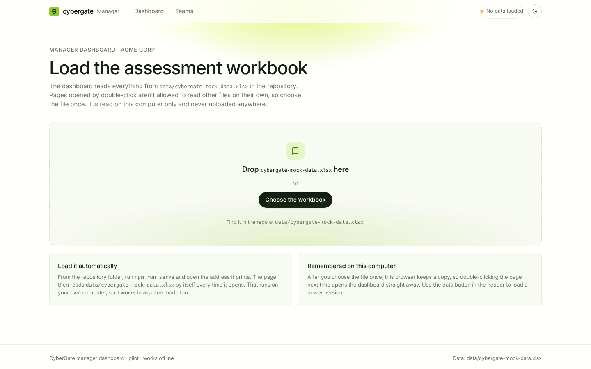

1. Click **Choose the workbook**, or drag the file onto the page.
2. Pick `data/cybergate-mock-data.xlsx` from the repo folder.
3. The dashboard opens. The browser keeps a copy of the workbook on this computer (in IndexedDB), so next time you double-click the file it opens straight away.

The file is read on your computer only. It is never uploaded anywhere.

### 4.3 `npm run dev` (for changing the code)

```bash
npm run dev
# → http://localhost:5173/cybergate-dashboard.html (opens automatically)
```

This is a live-reload development server: save a file in `src/` and the page updates. It also serves `data/`, so the workbook loads automatically.

### Loading a different workbook

At any time, click the **data button** in the header (it shows the file name and number of people), or drop an `.xlsx` file anywhere on the page. If the workbook is missing a sheet or a column the app needs, the page tells you exactly which one instead of showing wrong numbers.

---

## 5. Use the app

The app has three pages. The address bar changes as you move between them (`#/`, `#/teams?...`, `#/employee/...`), so you can bookmark or share a view.

The **sun/moon button** in the header switches between the light and dark theme. The first time, it follows your computer's setting; after you switch, it remembers your choice.

### 5.1 Dashboard: the overview (`#/`)

This is the first page you see.

**KPI cards.** Click a card to jump to the matching list.

| Card | What it shows |
| --- | --- |
| People assessed | How many have completed self-assessment, with a progress bar through validation and report |
| Critical positions | Lead, head and director roles, and how many have no ready successor |
| Critical gaps | High-priority competencies below requirement, and how many people they affect |
| Training completed | Share of started trainings that are done |
| Ready for promotion | Ready now, and ready in 6–12 months |
| Key-person risk | Competencies only one person in a team holds at expert level |
| Average role readiness | How well people meet the requirements of their current role |
| Certifications | Professional and AI certifications achieved in the current IDP cycle |

**Below the cards:**

- **Assessment progress:** how many people got through self-assessment, the validation interview and the report.
- **Promotion readiness:** everyone, by readiness group. Click a group to see those people.
- **Departments:** one card per department with readiness, critical gaps, people ready soon and key-person risks. Click to open the department.
- **Critical positions and their bench** (the dark section): every critical role, who holds it, and who could step in.

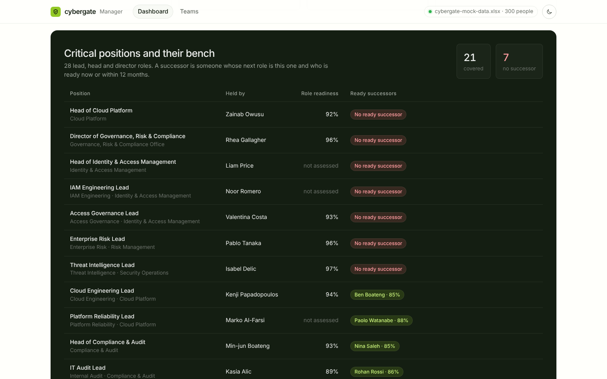

### 5.2 Teams: departments and sections (`#/teams`)

**Pick a department** with the buttons at the top, then optionally a **section**. Everything on the page updates for that group.

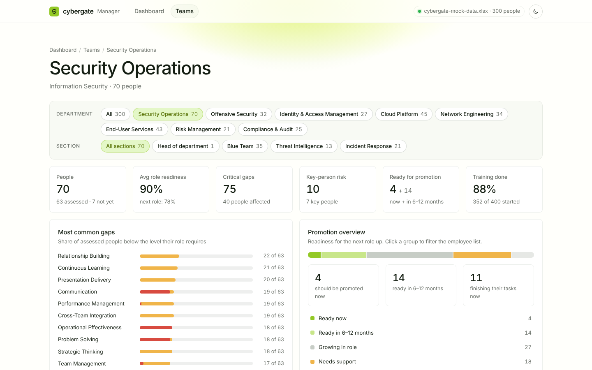

| Block | What it tells the manager |
| --- | --- |
| KPI strip | People, average readiness, critical gaps, key-person risk, ready for promotion, training done |
| **Most common gaps** | Which competencies most people are below requirement in. The red part means critical (High priority), so this is what to train next. |
| **Promotion overview** | How many should be promoted now, how many will be ready in 6–12 months, and how many are finishing their tasks. Click a group to filter the employee list. |
| **Tasks done, by assessment** | Training completion for each promotion group and each assessment stage |
| **Key-person risk** | Competencies only one person in the team holds at level 4+, and who that person is |
| **Performance × potential** | A 9-box: role readiness across, trainer-observed Leadership + Agility up |
| Readiness by section/department | Average readiness per team. Click to drill in. |

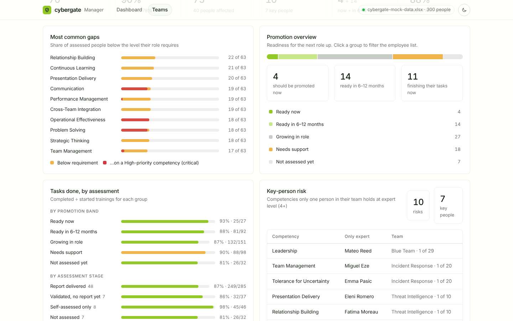

**Heatmaps**

- **Competency heatmap:** every person against every competency, weakest people first. The number is the assessed level, and the colour shows the level against what the role requires (above / meets / 1 below / 2+ below). For large groups the rows are sections instead of people.
- **Observed behaviours:** the 25 behaviours trainers scored during leadership programs, per person.

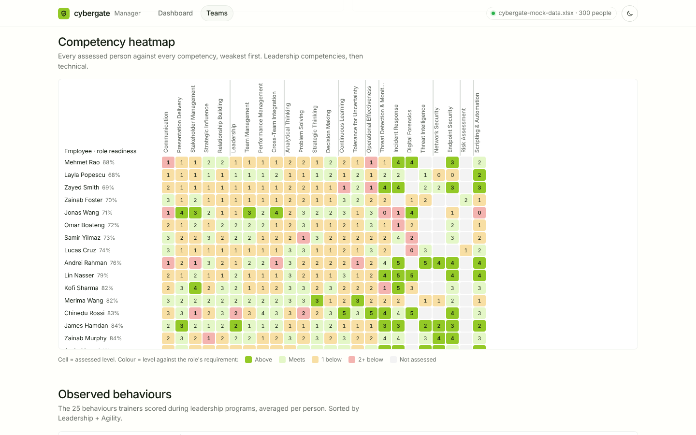

**Employees table.** Under each person's **next role** there is a progress line showing how close they are to it.

- **Search** by name, role or team.
- **Filter** by promotion group.
- **Sort** by clicking any column header.
- The table shows 50 people at a time; use **Show more** for the rest.
- **Click a row** to open that employee.

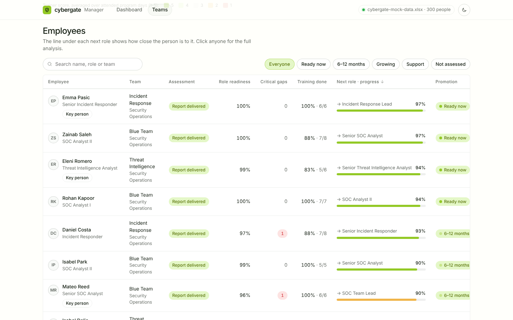

### 5.3 Employee: detailed analysis (`#/employee/<email>`)

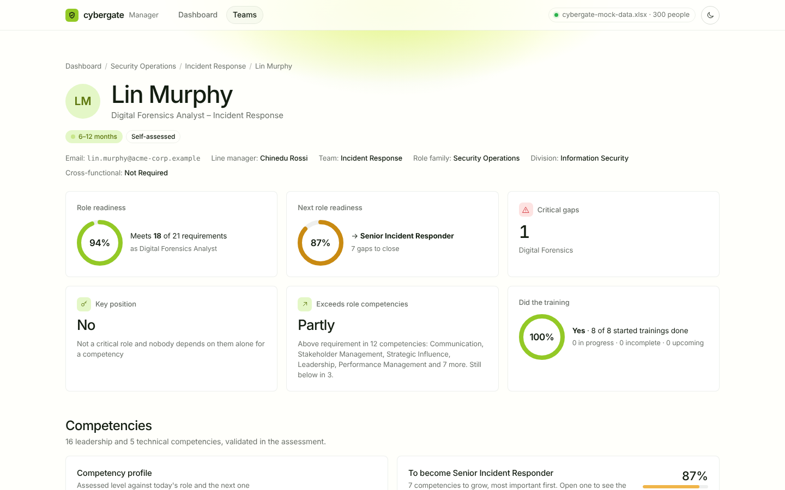

**Readiness cards**

| Card | Answers |
| --- | --- |
| Role readiness | How well they meet the requirements of their current role |
| Next role readiness | Which role is the logical next step, and how close they are |
| Critical gaps | Which High-priority competencies are below requirement |
| Key position | Do they hold a critical role, or are they the only expert in something? |
| Exceeds role competencies | Are they above requirement, and in which competencies? |
| Did the training | Done / in progress / incomplete / upcoming |

**Competencies**

- A radar chart of their assessed level against what's required now and in the next role.
- A list of what to grow for the next role. Open a competency to see **what that level looks like**, using the behaviours from the framework.
- A full competency table.

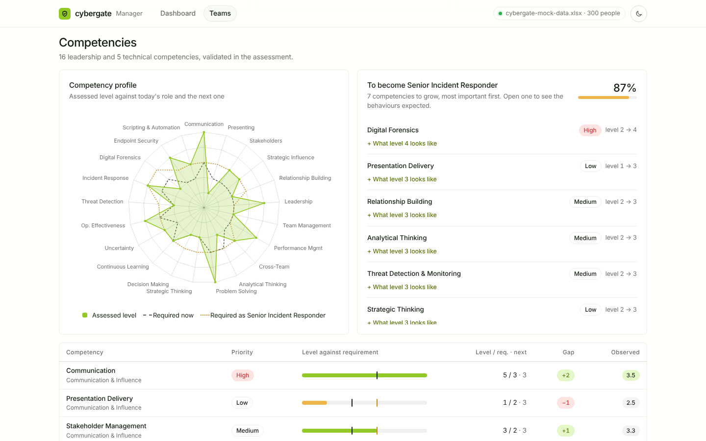

**Observed behaviours**

- A heatmap of all 25 trainer-scored behaviours for each program day.
- A day-by-day trend line.
- Leadership + Agility, coachability and growth scores.
- The trainer's notes.

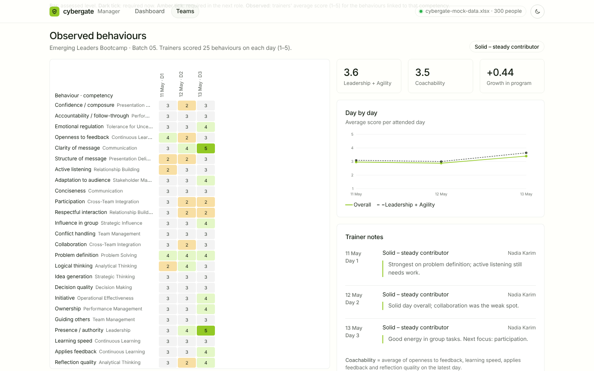

**Training and development**

- Every training with dates, status, attendance and hours.
- Certification goals per IDP cycle.
- The learning plan from their individual report.

### 5.4 Dark theme

Every page has a dark version.

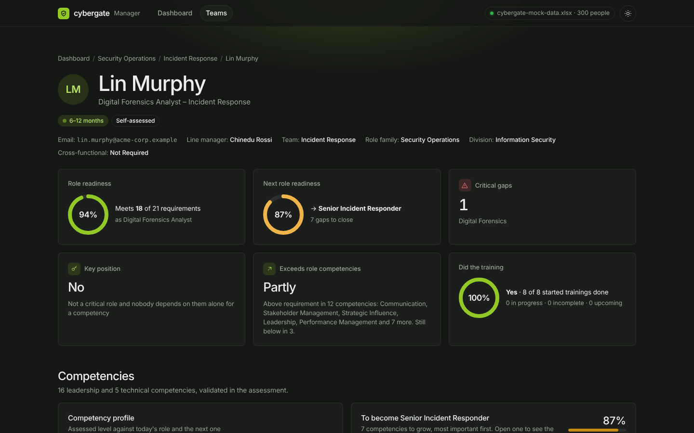

---

## 6. Build the final file (and screenshots)

```bash
npm run build
```

This does two things:

1. **Builds `build/cybergate-dashboard.html`.** Vite bundles `src/` into a single HTML file with all CSS and JavaScript inlined, as **one classic `<script>`**: no `type="module"`, no `import` at runtime, and no data inside.
2. **Takes fresh screenshots** into `docs/screenshots/`. It opens the new file in a headless browser, captures all three pages in light and dark (19 images), and **audits the network**: any request that would leave the computer is blocked and fails the build. Expected output:

   ```
   screenshots: 19 images in docs/screenshots/ (browser: Playwright Chromium)
   network audit: no request left this computer (only the page and data/cybergate-mock-data.xlsx were loaded)
   ```

**Screenshots need a browser.** The script uses the first of these it finds:

- Playwright's Chromium, installed once with `npx playwright install chromium` (a download)
- Google Chrome or Microsoft Edge already installed on the computer
- Any Chrome/Chromium at a path you give it: `CHROME_PATH=/path/to/chrome npm run build`

If none is found, the HTML file is still built and only the screenshots are skipped, with a message explaining why.

**Other commands**

| Command | Does |
| --- | --- |
| `npm run build:html` | Builds the HTML only, without screenshots |
| `npm run screenshots` | Retakes the screenshots without rebuilding |
| `npm run serve` | Serves the built page with the workbook (section 4.1) |
| `npm run dev` | Development server (section 4.3) |
| `npm run data` | Regenerates the mock workbook (section 7) |

`build/cybergate-dashboard.html` is committed to the repo, so people who only want to use the app can download it without building anything. Rebuild and commit it whenever you change something in `src/`.

---

## 7. The data: the Excel workbook

`data/cybergate-mock-data.xlsx` has the 8 tables of the CyberGate assessment as sheets, with these exact column names. The app reads them by name.

| Sheet | Rows | One row is | Used for |
| --- | --- | --- | --- |
| Employees | 300 | an employee: org placement, line manager, assessment status | Org filters, assessment progress |
| Competency Gaps | ~5,300 | employee × competency: level, required level, gap, priority | Readiness, gaps, heatmaps, next role |
| Competencies | 32 | a competency in the framework, with its scale | Names, categories, scales |
| Competency Behaviors | 320 | the behaviour expected at one level of a competency | "What this level looks like" |
| Training Records | ~2,000 | an employee in a training session | Training done, tasks |
| Training Day Scores | ~360 | an employee on a program day, with 25 behaviour scores | Behaviour heatmaps, potential, 9-box |
| IDP Certifications | 760 | an employee in an IDP cycle: professional + AI certification | Certifications |
| Learning Plans | 196 | an employee's plan: 5 segments + department need | Learning plan |

More detail (scales, profiles, gaps left in on purpose) is in [`data/CYBERGATE_MOCK_DATA.md`](data/CYBERGATE_MOCK_DATA.md).

**To use your own data**, replace `data/cybergate-mock-data.xlsx` with a workbook that has the same sheet and column names. Extra columns are fine. You don't need to rebuild: refresh the page (`npm run serve`) or load the file with the data button.

**To regenerate the mock data** (fixed seed, so it produces the same workbook every time):

```bash
pip install openpyxl
npm run data          # = python3 scripts/generate_cybergate_mock.py
```

---

## 8. Offline and network guarantees

The page can't reach the internet, by design:

- **One request only.** The page's only network-capable call is a `fetch` of `cybergate-mock-data.xlsx`, by relative path, from the same folder or server as the page itself. When opened by double-click it doesn't even do that: you hand it the file.
- **Content-Security-Policy.** Built into the page: `default-src 'none'; … connect-src 'self'`. Even if code tried to load anything from another address (scripts, fonts, images, API calls), the browser would block it.
- **Nothing external is referenced.**
  - No web fonts: it uses the system font, or Geist if installed.
  - No CDN, no analytics, no images from the web.
  - The only `http://` strings in the file are XML/SVG namespace names, which browsers never request.
- **The Excel reader is part of the page.** [`src/xlsx.js`](src/xlsx.js) unzips the workbook with the browser's built-in `DecompressionStream` and reads the XML with `DOMParser`. No library is involved. It was checked cell by cell against `read-excel-file` on all 8 sheets, and the output is identical.
- **Verified on every build.** `npm run build` blocks and reports any request that isn't the page or the workbook on this computer (see section 6).

The local server from `npm run serve` listens on `127.0.0.1` only. It serves nothing outside the repo and refuses `node_modules` and `.git`.

---

## 9. How the numbers are calculated

All metrics live in [`src/model.js`](src/model.js).

| Metric | Definition |
| --- | --- |
| Role readiness | Σ w·min(Level, Required) ÷ Σ w·Required, with Priority weights High 3, Medium 2, Low 1 |
| Next role | The closest more-senior assessed role in the same section. If there is none, the line manager's role. If that manager hasn't been assessed, requirements come from an assessed peer at the same level, and the role is marked "est." |
| Next-role readiness | The same formula, against the next role's required levels |
| Critical gap | A High-priority competency where Level < Required |
| Exceeds role | Meets every requirement and is above requirement in at least one competency |
| Key person | The only person in their team (teams with 3+ assessed staff) at level 4+ in a competency |
| Critical position | A role with Lead, Head, Director or Chief in the title |
| Successor | Someone whose next role is that position and who is Ready now or Ready in 6–12 months |
| Ready now | Next-role readiness of 92% or more, and no critical gaps |
| Ready in 6–12 months | Next-role readiness of 85% or more, and at most one critical gap |
| Growing in role | Role readiness of 85% or more |
| Needs support | Everyone else who has been assessed |
| Tasks done | Completed ÷ started trainings (started = completed, incomplete or in progress) |
| Potential (9-box) | Latest Leadership + Agility average from the trainers' observation days |
| Coachability | Average of the openness to feedback, learning speed, applies feedback and reflection quality scores on the latest attended day |

---

## 10. Project structure

```
cyberpunk-clone/
├── build/
│   └── cybergate-dashboard.html   ← the app: one file, open it or serve it
├── data/
│   ├── cybergate-mock-data.xlsx   ← the data the app reads (8 sheets)
│   └── CYBERGATE_MOCK_DATA.md     ← notes on the data
├── docs/screenshots/              ← made by `npm run build`
├── src/                           ← app source (plain JavaScript, no framework)
│   ├── main.js                    ← start-up, header, routing, theme, loading the workbook
│   ├── data.js                    ← where the workbook comes from + sheet/column checks
│   ├── xlsx.js                    ← the Excel reader (zip + XML, no library)
│   ├── normalize.js               ← sheet rows → { columns, rows }
│   ├── model.js                   ← joins the 8 sheets, calculates every metric
│   ├── charts.js                  ← hand-drawn SVG charts (ring, donut, radar, line, bars)
│   ├── ui.js                      ← shared components (cards, tags, heatmaps, employee table)
│   ├── util.js                    ← formatting and escaping helpers
│   ├── styles.css                 ← light + dark theme
│   └── pages/                     ← dashboard.js, teams.js, employee.js
├── scripts/
│   ├── serve.mjs                  ← `npm run serve`: local server, 127.0.0.1 only
│   ├── screenshots.mjs            ← screenshots + network audit, runs after the build
│   └── generate_cybergate_mock.py ← `npm run data`: regenerates the workbook
├── cybergate-dashboard.html       ← page template Vite builds from
├── vite.config.js                 ← single-file build, offline CSP, classic script
└── package.json
```

---

## 11. Troubleshooting

| Problem | Fix |
| --- | --- |
| Double-clicked the file and it asks for the workbook | Expected the first time (section 4.2). Choose `data/cybergate-mock-data.xlsx`, or use `npm run serve` to load it automatically. |
| "This workbook doesn't match the CyberGate layout" | The file is missing a sheet or column the app needs. The message lists which. Use `data/cybergate-mock-data.xlsx` or fix the sheet/column names. |
| `npm run serve` says the page is missing | Run `npm run build` (or `npm run build:html`) first. |
| `Port 4321 is busy` | `PORT=4322 npm run serve` |
| Screenshots skipped: no browser found | `npx playwright install chromium` once, or `CHROME_PATH=/path/to/chrome npm run build` |
| `npm install` fails offline | It needs the internet once to download the build tools. Everything after that is offline. |
| Changed the code but the page looks the same | Run `npm run build` again, then refresh. Or use `npm run dev` while editing. |
| Want to forget the remembered workbook | Clear this site's data in the browser, or simply load another file with the data button. |
